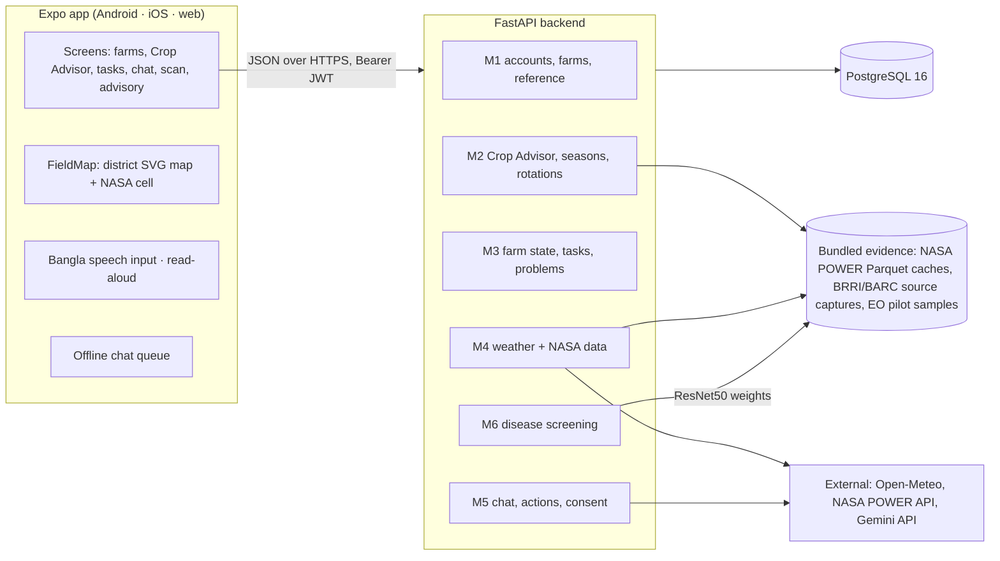
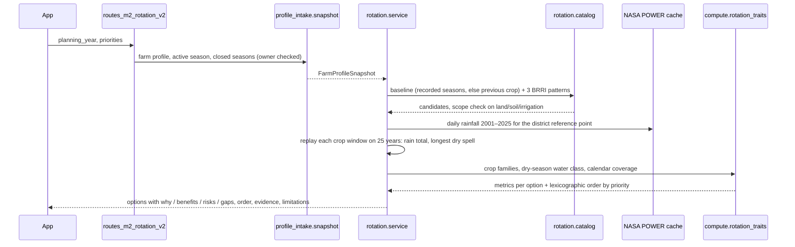

# FieldShift BD architecture

FieldShift BD is a phone-first farm helper for Bangladesh. A React Native (Expo) app talks to a FastAPI backend, which keeps farm records in PostgreSQL and reads NASA and Bangladeshi agricultural evidence from files bundled in the repository. This page explains how the parts fit together and where each responsibility lives.

## System overview



| Layer | Technology | Folder |
| --- | --- | --- |
| Mobile and web client | Expo SDK 57, React Native 0.86, Expo Router, TypeScript | `frontend/` |
| API | Python 3.12, FastAPI, Pydantic v2, SQLAlchemy 2, Alembic | `backend/app/` |
| Pure computation | Plain Python, no I/O | `backend/src/compute/` |
| Database | PostgreSQL 16 | `docker-compose.yml` service `db` |
| Evidence data | Parquet + JSON with manifests and SHA-256 hashes | `backend/data/`, `backend/app/data/` |
| Disease model | PyTorch ResNet50 checkpoint (Git LFS) | `backend/model/` |
| Local run | Docker Compose: `db`, `backend`, `frontend` | repository root |

## Backend modules

The backend is split into six modules. Each module owns its own tables and writes only its own data; modules talk to each other through typed contracts in `backend/app/contracts/`.

| Module | Owns | Key code |
| --- | --- | --- |
| **M1 Farmer and fields** | Accounts, farmer profile, farmlands, crop catalog, Bangladesh geography and profile vocabulary | `api/routes_m1_profile.py`, `api/routes_m1_catalog.py`, `services/m1_*`, `services/profile_intake/` |
| **M2 Crop Advisor** | Crop matching, season lifecycle and plans, harvest guidance, planting-window evidence, rotation comparison | `api/routes_m2_advisor.py`, `api/routes_m2_rotation_v2.py`, `services/m2_*`, `services/rotation/`, `services/district_advisory.py` |
| **M3 Farm state** | Active season state, growth stage, tasks, problems, check-ins | `api/routes_farm_state.py`, `services/farm_state*` |
| **M4 Weather and Earth data** | Weather providers, alert rules, NASA POWER history cache, Earth-observation acquisition and pilot samples | `api/routes_m4_weather.py`, `services/weather_*`, `services/climate/`, `services/earth_observation/` |
| **M5 Conversation** | Farm-scoped chat, intent classification, proposed actions and confirmation, consent records | `api/routes_m5_chat.py`, `api/routes_m5_actions.py`, `services/chat_engine.py`, `services/actions/` |
| **M6 Disease screening** | Leaf image checks, model inference, optional verification, scan history, hand-off to M3 problems | `api/routes_disease.py`, `services/disease*`, `services/gemini_verification.py` |

`app/main.py` mounts every router, sets CORS from `CORS_ORIGINS`, and turns a disabled feature switch into a `503` response.

## How a rotation comparison is built

This is the core decision-support path (`POST /advisor/v2/farmlands/{id}/rotation-comparisons`).



Design rules in this path:

- **Read-only.** The comparison never creates a season, task or problem.
- **No invented numbers.** A metric that cannot be computed is `missing` with a reason, never zero. An option missing the first priority's value is listed under `unranked_options` instead of getting a made-up score.
- **Reproducible order.** Options are sorted lexicographically on the chosen priorities using the values shown to the farmer (`src/compute/rotation_traits.py`).
- **Discussion, not selection.** `preferred_option_ids` stays empty and `selection_allowed` is always `false`; the farmer and their local agriculture officer decide.
- **Sources travel with results.** Every option lists `evidence_ids` that resolve to entries in `evidence[]` with coverage dates and spatial support.

## Data and evidence

| Source | What is stored | Where | Used for |
| --- | --- | --- | --- |
| NASA POWER Daily Point | Daily rainfall, temperature and solar radiation, 2001–2025, for BMD reference points in Rajshahi (5081), Chattogram (2015) and Dhaka (3026) | `backend/data/climate/cache/<district>/` (Parquet + manifest) | Rainfall onset, dry spells, rotation ranking, public advisory |
| NASA POWER API (live) | Last 30 days at the farm's coordinates | fetched on request | Weather assessment |
| GPM IMERG Final Daily V07 | One-day pilot sample | `backend/data/earth_observation/` | Context only |
| SRTM GL1 | Elevation tiles for pilot districts | `backend/data/earth_observation/` | Context only |
| BRRI cropping patterns, rice variety profiles | Captured page extracts with source URLs | `backend/app/data/m2_knowledge_sources/` | Rotation alternatives, season calendars |
| BARC crop zoning and Agri-Advisory Portal | Captured claims, imported into `agricultural_knowledge` with review status and expiry | `backend/app/data/source_captures/`, database | Crop matching |
| FieldShift rotation guidance | Qualitative why / benefits / risks per pattern, pending local review | `backend/app/data/m2_knowledge_sources/rotation_option_guidance.json` | Rotation explanations |
| Open-Meteo | 7-day forecast | fetched on request | Weather alerts |

The backend container imports reference data on every start (`python -m scripts.import_reference_data`); re-running changes nothing unless a source file changed. Knowledge rows expire 180 days after capture, so stale evidence stops matching.

The NASA POWER grid is 0.5° × 0.625°, about 55 × 63 km over Bangladesh. The app says so on screen and draws the cell on the field map, because the data describes the area, not one plot.

## Frontend

| Area | Files |
| --- | --- |
| Routing (Expo Router) | `frontend/src/app/` — `index.tsx` (landing), `auth/`, `farmlands/` (list, add, profile setup) and `farmlands/[id]/` (overview, crop-advisor, season-plan, tasks, problems, check-ins, alerts, chat, crop-health, resources), `advisory.tsx` (public district rainfall) |
| Shared state | `src/context/AppProvider.tsx` (session, farms, language) |
| API client | `src/services/api-client.ts` (token in `sessionStorage` on web, Secure Store on device) |
| Rotation UI | `src/components/rotation/ComparisonPanel.tsx`, `CalendarStepDetails.tsx` |
| Map | `src/components/FieldMap.tsx` + `src/data/bd-districts.generated.ts` (built by `frontend/scripts/build-bd-map.py` from geoBoundaries) |
| Voice | `src/services/m5-voice.ts` (Bangla speech recognition, `bn-BD`), `src/services/m5-speech.ts` (read aloud) |
| Offline | `src/services/m5-offline*.ts` (queues chat messages while offline) |
| Contracts | `src/modules/shared/contracts*.generated.ts`, generated from the backend Pydantic models |

The app is bilingual. Each farmer's `preferred_language` (`bn` or `en`) drives the Bangla or English text the API returns in its `*_bn` / `*_en` fields.

## Contracts between backend and frontend

Pydantic models in `backend/app/contracts/challenge/` are the single source of truth. Two scripts generate the TypeScript types and JSON Schemas, and CI fails if the generated files are stale:

```bash
cd backend
python scripts/export_challenge_contracts.py --check
python -m scripts.export_rotation_contracts > ../frontend/src/modules/shared/contracts-v2.generated.ts
```

## Security and privacy

- Passwords are hashed with Argon2; tokens are HS256 JWTs valid for 90 days.
- `SECRET_KEY` must be at least 32 characters or the API will not start.
- Every farm route checks ownership; another farmer's records return `404`.
- `EARTHDATA_TOKEN` and `GEMINI_API_KEY` stay on the server and are never sent to the client.
- Consent for personalised advice, offline storage, speech transcription and disease-problem sync is recorded through `/challenge/consents`.
- `OFFLINE_MODE=true` blocks every outbound call.

## Testing and CI

| Check | Command |
| --- | --- |
| Backend unit and API tests | `cd backend && python -m pytest -q` |
| One module | `python scripts/test_modules.py m2` (foundation, m1–m6) |
| PostgreSQL integration | `tests/test_pg_*` with `FIELDSHIFT_PG_TEST_DATABASE_URL` set |
| Contract freshness | `python scripts/export_challenge_contracts.py --check` |
| Frontend types, lint, tests | `cd frontend && npx tsc --noEmit && npm run lint && npm test` |

GitHub Actions (`.github/workflows/`) runs the contract checks, every module's unit tests and the PostgreSQL integration job on each push and pull request.

## Known limits

- Rotation comparison covers Rajshahi and Chattogram; NASA POWER caches exist for Rajshahi, Chattogram and Dhaka.
- IMERG and SRTM are shown as context and do not affect ranking. MODIS NDVI failed quality checks and is not used. SMAP soil moisture is planned.
- Rotation benefits are qualitative general agronomy; no yield, profit or soil change is measured.
- Weather alert thresholds are demo values pending agronomist review.
- The disease model's accuracy figures come from its upstream model card and have not been validated on Bangladeshi field photos.
