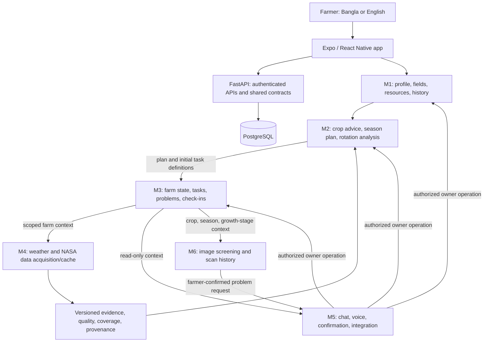
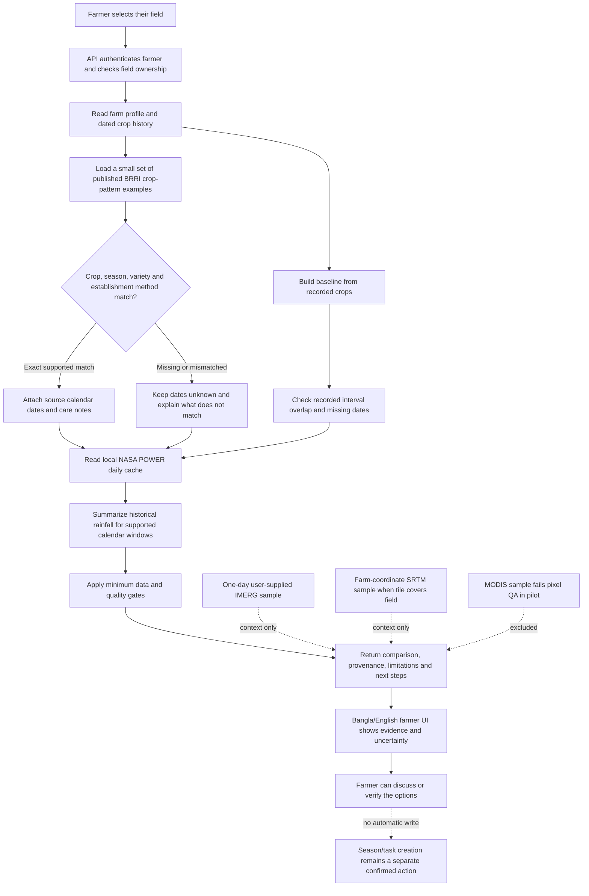

<p align="center">
  
</p>

<h1 align="center">🌾 FieldShift BD</h1>

<p align="center">
  <strong>Bangla-first field planning and farm support for Bangladesh</strong>
</p>

<p align="center">
  One connected experience for a farmer's field: create a farm profile, explore evidence-backed crop options, follow a season, track weather and field tasks, ask questions, and check a crop photo for possible disease.
</p>

<p align="center">
  
  
  
  
</p>

<p align="center">
  <a href="#product">Product</a> ·
  <a href="#architecture">Architecture</a> ·
  <a href="#modules">Modules</a> ·
  <a href="#data-and-evidence">Data and evidence</a> ·
  <a href="#quick-start">Quick start</a> ·
  <a href="docs/plans/TEAM_IMPLEMENTATION_ROADMAP.md">Team roadmap</a>
</p>

---

## Product

FieldShift BD is being built for NASA Space Apps Challenge 2026, **[Field Shift: Adapting Farms with NASA Data](https://www.spaceappschallenge.org/2026/challenges/field-shift-adapting-farms-with-nasa-data/)**. It combines NASA Earth-observation context with Bangladesh crop and farm information, while keeping data sources, uncertainty, and limits visible to the farmer.

The intended farmer journey is:

```text
Create an account → add a field and its known conditions → review suitable crop options
→ choose a crop and season → follow the plan and field tasks → ask questions or check a crop photo
→ record harvest and learn from the field's own history
```

Each suggestion depends on the evidence available for that location, crop, and season. Where the evidence is not sufficient, the app should say so instead of inventing a date, dose, or expected result.

> FieldShift BD is an independent project. NASA does not endorse it.

## Architecture

The app has a React Native/Expo client, a FastAPI backend, and PostgreSQL. Each module owns its domain data; shared contracts connect the modules. M5 coordinates chat and confirmed actions, while the domain owner performs each change.



The arrows show the intended ownership flow. A feature flag, typed contract, or test fake is not evidence that a live provider, complete farmer flow, or production integration is already available.

### Data and action flow

1. **M1** stores the farmer's account, chosen field, location, resources, crop history, and confirmed profile facts.
2. **M4** supplies weather and versioned environmental evidence. It records the source, dates, coverage, cache state, and spatial scale.
3. **M2** combines the saved farm profile with supported crop knowledge and climate evidence. It returns a recommendation or an explicit insufficient-evidence result. A plan contains definitions for M3; it does not create operational tasks itself.
4. **M3** owns live field state: active season, current growth stage, tasks, problems, and check-ins.
5. **M5** presents information in chat or voice and coordinates explicit confirmation for writes. The appropriate domain owner executes the approved change.
6. **M6** saves image-analysis results. Linking a possible disease result to an M3 farm problem requires the confirmed handoff flow.

## Modules

| Module | Owns | Current state and remaining work |
| --- | --- | --- |
| **M1 — Farmer and fields** | Accounts, profile, farm location, resources, and crop history | Core account and farm records exist. Complete progressive Bangla onboarding, field/locality correction, resource provenance, and the confirmed-fact flow. |
| **M2 — Crop Advisor** | Crop assessment, season lifecycle, plan definitions, and analytical recommendations | Recommendation and lifecycle APIs, annual climate comparison, limited BRRI calendar references, and a scoped rotation preview exist. Reviewed GDD/calendar rules, justified planting-window changes, and full rotation feasibility remain open. |
| **M3 — Farm management** | Operational farm state, tasks, problems, and check-ins | Core state and task APIs exist. Finish confirmed Plan B task diffs, operational date changes where supported, and the coordinated disease-to-problem lifecycle. |
| **M4 — Weather and Earth data** | Weather providers, NASA data ingestion, cache, quality, and provenance | Weather context and partial NASA POWER history exist. National cache coverage and ingestion of additional NASA datasets remain open. |
| **M5 — Chat, voice, and integration** | Farm-scoped conversation, language/voice presentation, confirmation, and shared integration | Chat and shared action/consent foundations exist. Complete the planned voice flows, action coordination across modules, user-facing offline behavior, and device verification. |
| **M6 — Disease checks** | Image quality, disease scan results, and model/verifier integration | Image screening, scan history, and optional Gemini verification exist. Model evaluation, source-backed care guidance, deployable model artifact handling, and complete confirmed handoff verification remain open. |

For the implementation sequence, per-module tasks, acceptance checks, and teammate handoff rules, see the [team implementation roadmap](docs/plans/TEAM_IMPLEMENTATION_ROADMAP.md). The [final consolidated plan](docs/plans/FINAL_IMPLEMENTATION_PLAN.md) remains the complete scope authority.

### Challenge fit: mission to implementation

The official challenge asks teams to use NASA Earth observations, local soil information, crop characteristics, and farmer priorities to explore rotation strategies for farms adapting to changing conditions. This table distinguishes the current prototype from the validation work still required.

| Challenge intent | FieldShift response today | Evidence status / next gate |
| --- | --- | --- |
| Explore and compare crop rotations | Crop Advisor shows the farmer's recorded sequence and three published crop-pattern examples | Partial comparison only. No “best” plan is selected until local suitability, calendars, turnaround, and comparable water metrics are reviewed. |
| Use NASA Earth observations | NASA POWER 2001–2025 reference-point history feeds historical rainfall summaries for matched calendar windows | Cache is available for three reference locations. IMERG and SRTM samples are context only; MODIS pilot pixels failed quality checks; the other registered NASA products are not integrated. |
| Include local soil/farm conditions | Saved soil, land type, irrigation availability, water source, location, and crop history are available to the farm-scoped comparison | Profile facts are farmer-entered and may be incomplete; the system does not convert them into a calibrated soil or crop-suitability score. |
| Respect farmer priorities | The farmer can choose a comparison priority and the UI retains it | It is explanatory context while evidence is incomplete, not a ranking weight that can create a preferred crop sequence. |
| Make trade-offs, uncertainty, and evidence visible | UI names sources, periods, scale, cache status, calendar matching, missing steps, and limitations in Bangla/English | Continue to add validated comparable metrics and uncertainty bounds before presenting trade-off scores. |
| Help farms adapt without overstating benefits | The prototype avoids unsupported soil-health/yield/water-saving claims and keeps the comparison read-only | A reviewed rotation may become actionable only after the evidence gates pass and the farmer separately confirms a season plan. |

The implementation aims to demonstrate a trustworthy decision-support approach; no README or feature can guarantee team selection. Judges should be able to reproduce the evidence, see the limitations, and understand what would change the prototype into a validated recommendation.

## Data and evidence

### NASA sources

NASA POWER daily history (2001–2025) is currently cached for representative points in Dhaka, Chattogram, and Rajshahi. Standard POWER meteorology uses a 0.5° × 0.625° grid; solar radiation uses a 1° × 1° grid. The selected BMD reference coordinates sample the corresponding source grid; they are not district averages or measurements of a farmer's field. The cache inventory and API expose the location, time span, variable coverage, retrieval time, and cache status.

The compact NASA POWER cache assets and BARC crop-suitability source captures are included for reproducible local use. Their manifests record coverage, retrieval, hashes, and source attribution. The BARC portal permits accurate reproduction with prominent source acknowledgement; see the captured policy and manifest under `backend/app/data/source_captures/barc_crop_zoning/`. These assets cover only the named locations and periods; they are not nationwide field-level measurements.

### Licensing and attribution

Original FieldShift BD source code and documentation are licensed under Apache-2.0. The bundled disease checkpoint, NASA POWER caches, BARC portal captures, and other third-party assets have separate terms; the root license does not replace them. Read [`NOTICE`](NOTICE) and the model's [`README`](backend/model/README.md) before reusing or redistributing those assets. NASA data use must not imply NASA endorsement.

Local prototype samples of IMERG and SRTM can be displayed separately from the decision using user-provided, unverified files. They are not validated production evidence. SMAP, MODIS NDVI, Landsat, ECOSTRESS, GRACE/GRACE-FO, GEDI, and NEX-GDDP-CMIP6 are not yet integrated into the comparison. The source register records their bounded roles and open license/product review: [`backend/data/climate/source-register.json`](backend/data/climate/source-register.json).

### Regional rotation development

The read-only v2 comparison supports **Rajshahi (5081)** and **Chattogram (2015)**. In Crop Advisor, select a planning year and priority to inspect recorded crops, published BRRI examples and the available NASA source evidence. It currently returns partial results: reviewed local crop dates and comparable irrigation-demand evidence are missing, so it does not choose or activate a preferred rotation.

Where a published variety, season, and establishment method match a rotation step, the comparison shows the source calendar and historical POWER rainfall across shorter and longer calendar windows. These are reference-point historical summaries, not a forecast, confidence interval, field water demand, or an adjusted planting recommendation. Source verification and agronomist review are distinct; the latter remains pending.

- `GET /advisor/v2/regions`: public inventory distinguishing existing POWER reference-point caches from registered, unacquired products.
- `POST /advisor/v2/farmlands/{farmland_id}/rotation-comparisons`: authenticated farm-owned comparison; no season/task/problem writes.
- `python -m scripts.prefetch_regional_evidence --help`: bounded NASA CMR discovery and optional sample download. Search rectangles are not district averages; metadata search is not ingestion. An Earthdata token and any required provider EULA approval are needed for protected downloads.
- Geo-worker dependencies are isolated in `backend/requirements-geo.txt` / `backend/Dockerfile.acquire`; the normal API does not require them. Raw downloads are ignored by Git. No multi-source regional raster release is published yet.
- `python -m scripts.stage_imerg_sample --help`: stage a downloaded IMERG V07 daily sample, retaining original source-cell support in a bounded pilot grid. The owner-provided 2024-01-01 granule has now been decoded and structurally reviewed, with full half-hour coverage required for valid daily cells. Its origin is not independently authenticated; a one-day pilot is context only and is not a decision input. Product/geometry review and a multi-year validated release remain pending.
- `python -m scripts.import_imerg_sample --help`: match a user-downloaded IMERG file against a saved NASA CMR discovery report and prepare a separate report for staging. The local file is explicitly marked user-supplied and unverified; the hash is an integrity identifier, not proof of source authenticity. See the [regional download guide](docs/research/2026-11-05-regional-dataset-downloads.md).
- Local `pilot-index.json` can enable a clearly labeled, one-day IMERG pilot. When a farm profile has coordinates inside the supplied regional SRTM tile, the API also reads the nearest SRTM grid node for that location. Both files remain unverified prototype context and neither changes crop ranking; SRTM is not a field survey or flood-risk estimate. The small pilot release and its four named source samples are included with this project; large raster/granule inputs use Git LFS. Download them with `git lfs pull`. New operational downloads should be kept outside the reviewed pilot release. See [pilot QA and limitations](docs/reviews/2026-11-05-real-satellite-pilot.md).

### Crop rotation: farmer-to-evidence flow

The rotation feature is a **read-only comparison prototype**, not an automatic crop selector. A farmer's priority is retained and shown, but it cannot override missing evidence or turn a partial comparison into a recommendation. The authenticated endpoint is scoped to the selected farmer-owned field; opening it does not create or edit a season, task, problem, or crop-history record.



#### What the comparison currently uses

| Evidence | Current role in rotation | What it can show | What it cannot support yet |
| --- | --- | --- | --- |
| NASA POWER daily cache, 2001–2025 | Historical comparison input for the Chattogram and Rajshahi rotation pilots; caches also exist for Dhaka in other climate/advisory paths | Rainfall summaries for source-matched calendar windows; cache/source/date/scale are shown | Field measurement, district average, forecast, crop water requirement, planting-date shift, or a winner among rotations |
| BRRI crop-pattern and variety references | Crop/season/method matching and published calendar context | Source dates and notes only when the crop pattern and establishment method match | Agronomist approval, complete local calendar coverage, or verified farm suitability |
| GPM IMERG V07 daily sample, 2024-01-01 | Optional **context only** pilot | One day, reported 0 mm weighted mean over each pilot rectangle, with 100% valid coverage and nine source cells in the local sample | Trend, current weather, farm rainfall, recommendation input, or independent source authentication |
| SRTMGL1 elevation sample | Optional **context only** pilot if coordinates fall inside a supplied tile | Nearest available terrain grid-node value at the farm profile coordinate | Field survey, slope, flood/erosion risk, or ranking input |
| MOD13Q1 NDVI sample | Excluded by pilot QA | Quality inspection only; Rajshahi pixel is marginal and Chattogram pixel is fill/no-data | A usable vegetation observation or crop-performance conclusion |
| SMAP, Landsat, ECOSTRESS, GRACE/GRACE-FO, GEDI and climate projections | Registered for possible future roles; not integrated into rotation | Nothing in the current comparison | Any current recommendation or score |

The local IMERG file was supplied by the owner and has not been independently authenticated; its single date is not a time series. SRTM and IMERG do not affect the result's status, scoring, or eligibility. The registry's POWER “decision” role means it is an input to the decision-support comparison; it does not mean that POWER alone scores or chooses a rotation. “Context only” products are not hidden scoring features.

#### Current output and evidence gates

The UI compares the field's recorded crop sequence with three published examples, uses the farmer's stated priority as comparison context, shows missing/mismatched calendar steps, and reports historical POWER rainfall exposure only where the source calendar matches. Recorded history is distinguished from planned or expected seasons; a planned crop is not treated as a completed harvest. Where dates are absent, the overlap/gap calculation is withheld. A possible gap between recorded dates is not called a verified fallow period or a required agronomic turnaround.

Today the API deliberately returns a **partial** result and `selection_allowed=false`. It withholds a preferred rotation because the project lacks reviewed local crop/variety calendars, crop-specific turnarounds, comparable irrigation demand, validated spatial boundaries, and independent agronomic review. It also does not claim soil-health, yield, cost, fertilizer, or water savings. This is a useful challenge prototype because it lets a farmer inspect alternatives and the available evidence without presenting unmeasured benefits as fact; it is not yet a farm-ready rotation prescription.

For a credible next release, the gates are: (1) source and agronomist review of crop calendars, varieties, establishment methods, turnaround and water assumptions; (2) independently verified district/farm geometry and additional multi-year NASA observations with documented QA; (3) comparable metrics and explicit uncertainty before any ranking; (4) farmer-facing explanation in both languages; and (5) a separate, confirmed transition from a reviewed option into M2/M3 season planning. Until those gates pass, keep exploration read-only and show “more evidence needed.”

See the [regional design](docs/superpowers/specs/2026-11-04-regional-nasa-rotation-design.md) and [implementation plan](docs/superpowers/plans/2026-11-04-regional-nasa-rotation-implementation.md). This increment does not complete the full plan or establish agronomic validation.

### Agronomic limits

- BRRI crop-calendar references are source-checked, but the project does not yet have the agronomist-reviewed crop calendar and cultivar GDD rules needed for a climate-adjusted planting recommendation.
- Historical rainfall timing is an observation, not a planting instruction. The app withholds a planting-window shift where the required reviewed rule is missing.
- Rotation examples apply only within their documented crop and farm conditions. The app does not claim unmeasured soil-health, yield, fertilizer, cost, or water benefits.
- A disease model result is an image-screening result, not a confirmed diagnosis. Gemini is optional and requires a server-side API key.
- The disease checkpoint is stored with Git LFS. Its upstream model card declares **CC BY-NC 4.0**; attribution is required and commercial use is not permitted under that license. Review [`backend/model/README.md`](backend/model/README.md) before reusing or redistributing it.

## Technology

| Layer | Technology |
| --- | --- |
| App | Expo SDK 57, React Native, Expo Router, TypeScript |
| API | Python 3.12, FastAPI, Pydantic, SQLAlchemy |
| Database | PostgreSQL 16, Alembic migrations |
| Local services | Docker Compose |
| Climate calculations | Deterministic Python functions with versioned source/cache metadata |
| Disease screening | Local model integration; optional Gemini verification |

## Quick start

### Requirements

- Git
- Git LFS (required to retrieve the disease model checkpoint)
- Docker Desktop with Docker Compose

After cloning, fetch the Git LFS files before building the backend image:

```bash
git lfs install
git lfs pull
```

### Configure

From the repository root, copy the sample configuration files:

```bash
cp .env.example .env
cp backend/.env.example backend/.env
```

On Windows PowerShell:

```powershell
Copy-Item .env.example .env
Copy-Item backend/.env.example backend/.env
```

### Start the app

```bash
docker compose up --build
```

| Service | Local address |
| --- | --- |
| Expo web app | <http://localhost:8082> |
| API | <http://localhost:8000> |
| Interactive API documentation | <http://localhost:8000/docs> |
| Health check | <http://localhost:8000/health> |

Stop with `Ctrl+C` or `docker compose down`. The named PostgreSQL volume remains after `docker compose down`; `docker compose down -v` deletes it.

For local Expo development, use Node.js/npm, run `npm ci` from `frontend/`, then `npm start`. Set `EXPO_PUBLIC_API_URL` to an address reachable from the browser, emulator, or phone. A phone cannot use its own `localhost` to reach the development computer. Docker Compose serves the web app and does not include Android or iOS simulators.

## Verification

Backend checks (Python 3.12; run from `backend/`):

```bash
python -m pip install -r requirements.txt -r requirements-test.txt
python -m pytest tests -q
```

Frontend checks (run from `frontend/`):

```bash
npm test
npm run lint
npx tsc --noEmit
```

Database model or migration changes also require migration and schema checks against a disposable PostgreSQL test database. Browser checks do not replace physical Android verification for camera, voice, permissions, or offline behavior.

## Project map

| Path | Purpose |
| --- | --- |
| `backend/app/api/` | FastAPI routes |
| `backend/app/services/` | Domain logic and external data providers |
| `backend/app/models/` | Database models |
| `backend/src/compute/` | Deterministic science and climate calculations |
| `backend/data/climate/` | Source register and local climate cache |
| `backend/tests/` | API, domain, contract, and data-pipeline checks |
| `frontend/src/app/` | Expo Router screens |
| `frontend/src/components/` | Shared user interface |
| `frontend/src/modules/` | Module exports and shared contracts |
| `docs/plans/` | Project plan, module briefs, and teammate roadmap |
| `docs/research/`, `docs/reviews/` | Dated source research and verification records |

## Team entry points

1. Start with [`docs/plans/TEAM_IMPLEMENTATION_ROADMAP.md`](docs/plans/TEAM_IMPLEMENTATION_ROADMAP.md) for the current work order and module tasks.
2. Read the matching module brief in [`docs/plans/module-briefs/`](docs/plans/module-briefs/), then the [team AI-agent starter](docs/plans/TEAMMATE_AI_AGENT_STARTER.md).
3. Check [`docs/plans/FOUNDATION_AND_PARALLEL_WORK.md`](docs/plans/FOUNDATION_AND_PARALLEL_WORK.md) for shared-file ownership and integration rules.
4. Keep `.env` files, API keys, and farmer credentials out of Git. The disease checkpoint is the sole large model asset and is versioned through Git LFS under the upstream non-commercial license documented in `backend/model/README.md`. Never put private values in `EXPO_PUBLIC_*` variables.

The project plans, source reviews, module contracts, and task records are retained under `docs/`, `backend/docs/`, and `backend/data/climate/`; they document decisions and evidence and should not be removed as setup clutter.
