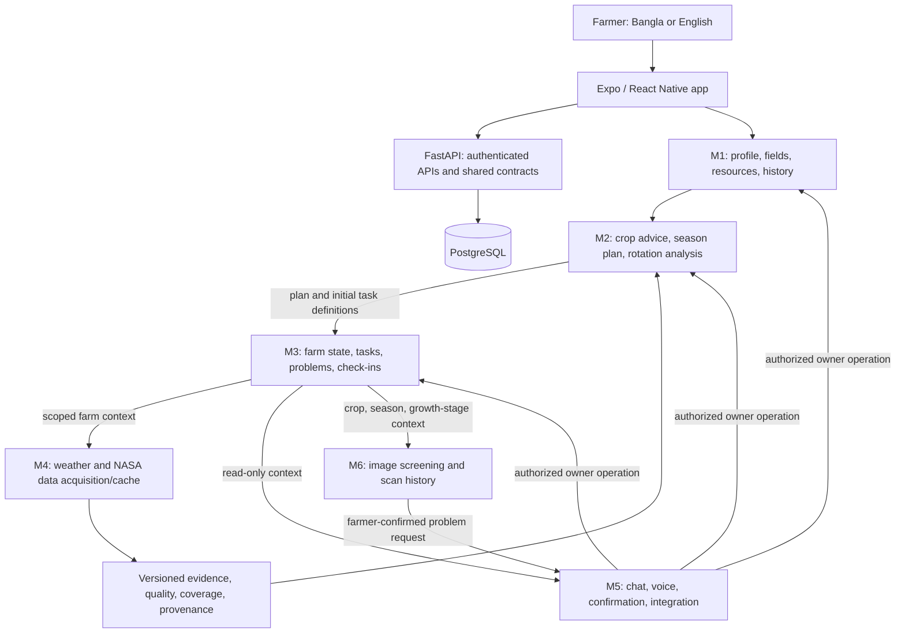

<p align="center">
  
</p>

<h1 align="center">🌾 FieldShift BD</h1>

<p align="center">
  <strong>Bangla-first field planning and farm support for Bangladesh</strong>
</p>

<p align="center">
  One connected experience for a farmer's field: create a farm profile, explore evidence-backed crop options, follow a season, track weather and field tasks, ask questions, and check a crop photo for possible disease.
</p>

<p align="center">
  
  
  
  
</p>

<p align="center">
  <a href="#product">Product</a> ·
  <a href="#architecture">Architecture</a> ·
  <a href="#modules">Modules</a> ·
  <a href="#data-and-evidence">Data and evidence</a> ·
  <a href="#quick-start">Quick start</a> ·
  <a href="docs/plans/TEAM_IMPLEMENTATION_ROADMAP.md">Team roadmap</a>
</p>

---

## Product

FieldShift BD is being built for NASA Space Apps Challenge 2026, **Field Shift: Adapting Farms with NASA Data**. It combines NASA Earth-observation context with Bangladesh crop and farm information, while keeping data sources, uncertainty, and limits visible to the farmer.

The intended farmer journey is:

```text
Create an account → add a field and its known conditions → review suitable crop options
→ choose a crop and season → follow the plan and field tasks → ask questions or check a crop photo
→ record harvest and learn from the field's own history
```

Each suggestion depends on the evidence available for that location, crop, and season. Where the evidence is not sufficient, the app should say so instead of inventing a date, dose, or expected result.

> FieldShift BD is an independent project. NASA does not endorse it.

## Architecture

The app has a React Native/Expo client, a FastAPI backend, and PostgreSQL. Each module owns its domain data; shared contracts connect the modules. M5 coordinates chat and confirmed actions, while the domain owner performs each change.



The arrows show the intended ownership flow. A feature flag, typed contract, or test fake is not evidence that a live provider, complete farmer flow, or production integration is already available.

### Data and action flow

1. **M1** stores the farmer's account, chosen field, location, resources, crop history, and confirmed profile facts.
2. **M4** supplies weather and versioned environmental evidence. It records the source, dates, coverage, cache state, and spatial scale.
3. **M2** combines the saved farm profile with supported crop knowledge and climate evidence. It returns a recommendation or an explicit insufficient-evidence result. A plan contains definitions for M3; it does not create operational tasks itself.
4. **M3** owns live field state: active season, current growth stage, tasks, problems, and check-ins.
5. **M5** presents information in chat or voice and coordinates explicit confirmation for writes. The appropriate domain owner executes the approved change.
6. **M6** saves image-analysis results. Linking a possible disease result to an M3 farm problem requires the confirmed handoff flow.

## Modules

| Module | Owns | Current state and remaining work |
| --- | --- | --- |
| **M1 — Farmer and fields** | Accounts, profile, farm location, resources, and crop history | Core account and farm records exist. Complete progressive Bangla onboarding, field/locality correction, resource provenance, and the confirmed-fact flow. |
| **M2 — Crop Advisor** | Crop assessment, season lifecycle, plan definitions, and analytical recommendations | Recommendation and lifecycle APIs, annual climate comparison, limited BRRI calendar references, and a scoped rotation preview exist. Reviewed GDD/calendar rules, justified planting-window changes, and full rotation feasibility remain open. |
| **M3 — Farm management** | Operational farm state, tasks, problems, and check-ins | Core state and task APIs exist. Finish confirmed Plan B task diffs, operational date changes where supported, and the coordinated disease-to-problem lifecycle. |
| **M4 — Weather and Earth data** | Weather providers, NASA data ingestion, cache, quality, and provenance | Weather context and partial NASA POWER history exist. National cache coverage and ingestion of additional NASA datasets remain open. |
| **M5 — Chat, voice, and integration** | Farm-scoped conversation, language/voice presentation, confirmation, and shared integration | Chat and shared action/consent foundations exist. Complete the planned voice flows, action coordination across modules, user-facing offline behavior, and device verification. |
| **M6 — Disease checks** | Image quality, disease scan results, and model/verifier integration | Image screening, scan history, and optional Gemini verification exist. Model evaluation, source-backed care guidance, deployable model artifact handling, and complete confirmed handoff verification remain open. |

For the implementation sequence, per-module tasks, acceptance checks, and teammate handoff rules, see the [team implementation roadmap](docs/plans/TEAM_IMPLEMENTATION_ROADMAP.md). The [final consolidated plan](docs/plans/FINAL_IMPLEMENTATION_PLAN.md) remains the complete scope authority.

## Data and evidence

### NASA sources

NASA POWER daily history is currently cached for a limited set of representative points, including Dhaka, Chattogram, and Rajshahi. The grid is approximately 50 km and represents area-level weather; it is not a measurement of a farmer's field or an average of every place in a district.

The compact NASA POWER cache assets and BARC crop-suitability source captures are included for reproducible local use. Their manifests record coverage, retrieval, hashes, and source attribution. The BARC portal permits accurate reproduction with prominent source acknowledgement; see the captured policy and manifest under `backend/app/data/source_captures/barc_crop_zoning/`. These assets cover only the named locations and periods; they are not nationwide field-level measurements.

Other sources in the register—including GPM IMERG, SMAP, MODIS NDVI, Landsat, ECOSTRESS, GRACE/GRACE-FO, SRTM, GEDI, and NEX-GDDP-CMIP6—are planned sources, not currently ingested app datasets. The source register records their bounded roles and open license/product review: [`backend/data/climate/source-register.json`](backend/data/climate/source-register.json).

### Agronomic limits

- BRRI crop-calendar references are source-checked, but the project does not yet have the agronomist-reviewed crop calendar and cultivar GDD rules needed for a climate-adjusted planting recommendation.
- Historical rainfall timing is an observation, not a planting instruction. The app withholds a planting-window shift where the required reviewed rule is missing.
- Rotation examples apply only within their documented crop and farm conditions. The app does not claim unmeasured soil-health, yield, fertilizer, cost, or water benefits.
- A disease model result is an image-screening result, not a confirmed diagnosis. Gemini is optional and requires a server-side API key.
- The disease checkpoint is stored with Git LFS. Its upstream model card declares **CC BY-NC 4.0**; attribution is required and commercial use is not permitted under that license. Review [`backend/model/README.md`](backend/model/README.md) before reusing or redistributing it.

## Technology

| Layer | Technology |
| --- | --- |
| App | Expo SDK 57, React Native, Expo Router, TypeScript |
| API | Python 3.12, FastAPI, Pydantic, SQLAlchemy |
| Database | PostgreSQL 16, Alembic migrations |
| Local services | Docker Compose |
| Climate calculations | Deterministic Python functions with versioned source/cache metadata |
| Disease screening | Local model integration; optional Gemini verification |

## Quick start

### Requirements

- Git
- Git LFS (required to retrieve the disease model checkpoint)
- Docker Desktop with Docker Compose

After cloning, fetch the Git LFS files before building the backend image:

```bash
git lfs install
git lfs pull
```

### Configure

From the repository root, copy the sample configuration files:

```bash
cp .env.example .env
cp backend/.env.example backend/.env
```

On Windows PowerShell:

```powershell
Copy-Item .env.example .env
Copy-Item backend/.env.example backend/.env
```

### Start the app

```bash
docker compose up --build
```

| Service | Local address |
| --- | --- |
| Expo web app | <http://localhost:8082> |
| API | <http://localhost:8000> |
| Interactive API documentation | <http://localhost:8000/docs> |
| Health check | <http://localhost:8000/health> |

Stop with `Ctrl+C` or `docker compose down`. The named PostgreSQL volume remains after `docker compose down`; `docker compose down -v` deletes it.

For local Expo development, use Node.js/npm, run `npm ci` from `frontend/`, then `npm start`. Set `EXPO_PUBLIC_API_URL` to an address reachable from the browser, emulator, or phone. A phone cannot use its own `localhost` to reach the development computer. Docker Compose serves the web app and does not include Android or iOS simulators.

## Verification

Backend checks (Python 3.12; run from `backend/`):

```bash
python -m pip install -r requirements.txt -r requirements-test.txt
python -m pytest tests -q
```

Frontend checks (run from `frontend/`):

```bash
npm test
npm run lint
npx tsc --noEmit
```

Database model or migration changes also require migration and schema checks against a disposable PostgreSQL test database. Browser checks do not replace physical Android verification for camera, voice, permissions, or offline behavior.

## Project map

| Path | Purpose |
| --- | --- |
| `backend/app/api/` | FastAPI routes |
| `backend/app/services/` | Domain logic and external data providers |
| `backend/app/models/` | Database models |
| `backend/src/compute/` | Deterministic science and climate calculations |
| `backend/data/climate/` | Source register and local climate cache |
| `backend/tests/` | API, domain, contract, and data-pipeline checks |
| `frontend/src/app/` | Expo Router screens |
| `frontend/src/components/` | Shared user interface |
| `frontend/src/modules/` | Module exports and shared contracts |
| `docs/plans/` | Project plan, module briefs, and teammate roadmap |
| `docs/research/`, `docs/reviews/` | Dated source research and verification records |

## Team entry points

1. Start with [`docs/plans/TEAM_IMPLEMENTATION_ROADMAP.md`](docs/plans/TEAM_IMPLEMENTATION_ROADMAP.md) for the current work order and module tasks.
2. Read the matching module brief in [`docs/plans/module-briefs/`](docs/plans/module-briefs/), then the [team AI-agent starter](docs/plans/TEAMMATE_AI_AGENT_STARTER.md).
3. Check [`docs/plans/FOUNDATION_AND_PARALLEL_WORK.md`](docs/plans/FOUNDATION_AND_PARALLEL_WORK.md) for shared-file ownership and integration rules.
4. Keep `.env` files, API keys, and farmer credentials out of Git. The disease checkpoint is the sole large model asset and is versioned through Git LFS under the upstream non-commercial license documented in `backend/model/README.md`. Never put private values in `EXPO_PUBLIC_*` variables.

The project plans, source reviews, module contracts, and task records are retained under `docs/`, `backend/docs/`, and `backend/data/climate/`; they document decisions and evidence and should not be removed as setup clutter.
