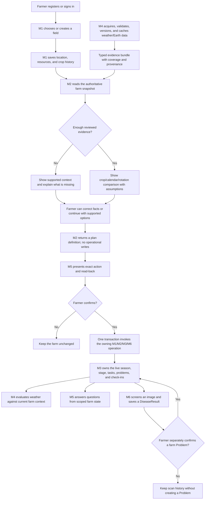

# FieldShift BD — Team Implementation Roadmap

**Goal:** Give six contributors a shared, practical work order for completing the farmer experience without crossing module ownership or overstating what the current code and data support.

**Architecture:** Keep the existing Expo app, FastAPI API, PostgreSQL records, and six domain modules. Each module owns its records and rules; typed contracts carry information between modules. M5 coordinates user intent and confirmation, while the relevant domain owner performs the write.

**Tech stack:** Expo SDK 57, React Native, TypeScript, Python 3.12, FastAPI, SQLAlchemy, Alembic, PostgreSQL 16, Docker Compose.

**Authority:** This roadmap is an execution guide. The complete requirements and acceptance gates remain in [FINAL_IMPLEMENTATION_PLAN.md](FINAL_IMPLEMENTATION_PLAN.md), with module ownership in [plan.md](../../plan.md) and the executable [ownership contract](../../backend/contracts/README.md).

## Read this first

Use these documents together:

1. [Final consolidated implementation plan](FINAL_IMPLEMENTATION_PLAN.md) — complete scope, organizer requirements, adaptive features, voice, safety, and release gates.
2. [Foundation and parallel-work guide](FOUNDATION_AND_PARALLEL_WORK.md) — shared code ownership, existing contracts, integration steward, and branch isolation.
3. [Assigned module brief](module-briefs/) — owned files, required behavior, and module tests.
4. [Teammate AI-agent starter](TEAMMATE_AI_AGENT_STARTER.md) — repository inspection and handoff instructions.
5. [Database schema](../../DB_SCHEMA.md) and actual API routes/schemas — verify the implementation rather than relying on old screenshots or sample payloads.

This roadmap does not replace an assigned module brief or silently remove a final-plan requirement. If the current evidence cannot support a recommendation, return an explicit unavailable/insufficient-evidence result and leave the relevant completion gate open.

## Current working-copy note

At the time this roadmap was written, the shared checkout was on branch `arijit` at commit `27e9b00` and had extensive uncommitted changes. That committed SHA does not include the uncommitted work. **Do not create teammate branches from the dirty checkout or copy its files into module branches as a shared base.** The team lead should first review and preserve the existing changes, choose a clean verified base, record its exact SHA, and then create isolated checkouts. This is a safety note about the current workspace, not a request to discard or commit anyone's work.

## What is already in place

The repository has a functioning application foundation and existing module code; it is not an empty scaffold. The shared foundation guide reports versioned contracts, typed ports, generated JSON Schema/TypeScript, synthetic test fakes, runtime composition and feature flags, an action/receipt/outbox persistence spine, module frontend seams, CI checks, and six module briefs.

Existing product code includes farmer and farm records, crop-advisor/season lifecycle routes, operational farm-state/task/problem/check-in APIs, weather providers, farm-scoped chat, disease image analysis, and related Expo screens. These capabilities vary in completeness; a route, fake, feature flag, or historical green test count does not prove the complete farmer flow is finished.

### Module status at a glance

| Module | Current footing | Main open work |
| --- | --- | --- |
| **M1 — Farmer and fields** | Account, profile, farmland, and reference-data foundation | Progressive Bangla onboarding, full field/locality/resource facts, correction/consent/provenance flow |
| **M2 — Crop Advisor** | Crop assessment and season lifecycle; NASA annual comparison; limited BRRI calendar references; scoped rotation preview | Reviewed agronomy, supported planting-window policy, full rotation feasibility and adaptive analysis |
| **M3 — Farm management** | Farm state, season stages, tasks, problems, and check-ins | Safe confirmed Plan B task diffs, approved rescheduling, coordinated M6 problem handoff |
| **M4 — Weather and Earth data** | Weather provider context, NASA POWER code, and a small set of saved 2001–2025 representative-point histories | 64-district QA/cache, source-specific ingestion for additional datasets, map/evidence freshness flow |
| **M5 — Chat, voice, integration** | Farm-scoped chat and shared action/consent/transaction foundation | Complete F1–F9 farmer flows, action orchestration across owners, voice/device behavior, durable offline and delivery |
| **M6 — Disease checks** | Image analysis/history and optional Gemini verification; a consent-aware Problem sync route exists | Model evaluation and release artifact, image coaching/source-backed guidance, end-to-end M3/M5 confirmation and device checks |

The NASA POWER cache currently covers only a limited set of representative points (Dhaka, Chattogram, and Rajshahi). See the dated [district cache record](../reviews/2026-11-01-district-cache-inventory-delivery.md) and the [source register](../../backend/data/climate/source-register.json). Check local cache inventory before saying any district is covered.

## Farmer journey and architecture flow

The diagram describes the target flow, not a claim that every arrow has passed end-to-end verification. NASA ingestion/cache is M4-owned; analysis and recommendation policy are M2-owned; operational tasks/problems/current stage are M3-owned; M5 presents and coordinates confirmation; M6 owns disease scan results.

## Shared interfaces and ownership

| Producer | Consumer | Contract / handoff | Rule |
| --- | --- | --- | --- |
| M1 | M2 | Saved farm profile snapshot, canonical location, resources, crop history, revision | M1 remains the source of truth; M2 must not trust client-supplied duplicate profile facts. |
| M4 | M2 | Versioned climate evidence bundle and provenance | M4 fetches, validates, caches, and reports coverage; M2 computes agronomic meaning. |
| M2 | M3 | Crop-season plan, growth-stage definitions, initial task definitions | M2 defines a plan; M3 creates and owns operational task rows. |
| M3 | M4/M5/M6 | Authenticated, farm-scoped current state | Consumers read; M3 writes the live task/problem/current-stage state. |
| M6 | M5 → M3 | Saved DiseaseResult, typed proposed problem, separate consent/confirmation and receipt | A scan does not silently become a farm Problem. M3 owns Problem creation/reuse. |
| M1/M2/M3/M6 | M5 | Owner operation and transaction-aware adapter | M5 coordinates one request/receipt/outbox; it must not write another module's tables directly. |

The shared contracts and shared files have one integration steward (a role held by one of the six people, normally the M5 owner). See the [single-writer list](FOUNDATION_AND_PARALLEL_WORK.md#5-single-writer-shared-files). If a feature needs a shared model, migration, generated type, global router, or common screen change, the module owner submits an exact patch request to the steward and continues independent work meanwhile.

## Module work plans

Each task below is an open implementation goal unless a module owner verifies it in the current branch and records evidence. Suggested paths are relative to the repository root; confirm exact filenames before editing.

### M1 — Farmer and fields

**Owns:** account/profile/farm facts, locality, resources, crop history, consent and profile correction.

**Consumes:** shared authentication and canonical location references. **Produces:** authoritative farm snapshots and confirmed profile facts for M2/M4/M5.

**Current starting paths:** `backend/app/api/routes_m1_profile.py`, `routes_m1_catalog.py`, `backend/app/schemas/profile.py`, `backend/app/services/m1_reference.py`, `backend/app/services/profile_intake/`, `frontend/src/app/auth/`, `frontend/src/app/farmlands/`, and `frontend/src/services/farm-location.ts`.

- [ ] Preserve existing registration, verification, sign-in, ownership checks, and the list-all-farms → choose-one-farm entry flow.
- [ ] Complete progressive onboarding that asks only for missing facts and supports correction, skip, and “I don't know”. Persist division, district, upazila, and village/locality as separate fields.
- [ ] Save land area and original unit; soil/land type and source; irrigation/water source; equipment; budget; farmer-reported crop/yield history; priorities; and the distinction between farmer report, regional evidence, and lab measurement.
- [ ] Make location selection usable without GPS. Explain that phone GPS is the phone's position; only save it as the farm location after the farmer confirms or edits it.
- [ ] Connect consent/preferences/withdrawal and confirmed answers to the shared versioned action flow. A hypothetical answer used for preview must not silently update the saved farm.
- [ ] Add Bangla and English correction, validation, and error states; test restart/reload persistence and account/farm switching.

**Acceptance:** two farmers/two farms remain isolated; missing/unknown/zero/false differ; denied location permission has a manual path; saved changes survive reload; stale/duplicate confirmation cannot silently overwrite newer farm facts.

**Brief:** [M1 module brief](module-briefs/M1.md).

### M2 — Crop Advisor and season lifecycle

**Owns:** crop fit reasoning, analytical rules, season selection/plan definitions, stage definitions, harvest guidance, and season outcome history. M2 does not own M3's live tasks or current operational stage.

**Consumes:** M1's server-authoritative farm snapshot and M4's dated, versioned evidence. **Produces:** typed bilingual advice, comparison, plan/task definitions, uncertainty and provenance for the farmer, M5, and M3.

**Current starting paths:** `backend/src/compute/agro.py`, `backend/app/api/routes_m2_advisor.py`, `backend/app/services/m2_advisor.py`, `backend/app/services/district_advisory.py`, `backend/app/services/rotation_comparison.py`, `backend/app/schemas/planting_window.py`, `frontend/src/app/advisory.tsx`, `frontend/src/app/farmlands/[id]/crop-advisor.tsx`, and `frontend/src/components/RotationComparisonCard.tsx`.

- [ ] Maintain claim-level source records for crop/variety/season calendars, establishment method, nursery age, GDD base/cap/method/target, and stage/task timing. Ask a Bangladesh agronomist/BRRI/DAE reviewer to approve each production rule; without review, show source reference or `insufficient_data`, not an operational recommendation.
- [ ] Keep onset, GDD, annual comparison, Mann–Whitney U/effect, 15/20/25 mm sensitivity, exclusions, and uncertainty deterministic and separately tested. Preserve missing values, no-onset vs. incomplete tail, time standard, and observed-vs-recommended distinction.
- [ ] Connect approved crop-calendar rows and M4 evidence to authenticated planting-window results. Calculate a planting-window shift only when the crop/season rule and farm constraints support it; return `null`/insufficient evidence otherwise.
- [ ] Complete rotation comparison with the farmer's recorded sequence plus at least two locally supported alternatives. Check dated calendars, irrigation/water, soil/land, crop-family/pest and resource constraints; explain source-backed tradeoffs, missing factors, and unavailable measurements. Do not invent yield, cost, nutrient, carbon, or water benefits.
- [ ] Implement A01 (one decision-changing field question), A02 (bounded feasible ranges with binding constraints), and A03 (versioned conditional Plan B preview) as non-mutating analysis first. Keep hypothetical answers separate from confirmed M1 facts.
- [ ] Return a complete M2 plan definition to M3. On season selection or action confirmation, use owner operations through the shared transaction seam; never insert M3 task rows from M2.
- [ ] Localize advisory, assumptions, limitations, source dates, SMS-length copy, and errors in Bangla/English. Display NASA period, scale, source, and cache status next to the affected evidence.

**Acceptance:** hand-calculated onset/GDD/statistics cases pass; unsupported profiles return explicit gaps; authenticated results enforce farm ownership; no writes occur from comparison/preview; supported production advice has reviewed source references; M2 → M3 task materialization is idempotent and verified.

**Brief:** [M2 module brief](module-briefs/M2.md). **Evidence note:** [crop calendar/GDD review](../research/2026-11-01-crop-calendar-and-gdd-evidence.md).

### M3 — Farm management

**Owns:** assembled farm operational state, active-season/current-stage state, task lifecycle, Problems, check-ins, and owner-side task/problem writes.

**Consumes:** M2 plan definitions and M5's exact confirmed action payload. **Produces:** authenticated scoped state for the farmer, M4, M5, and M6.

**Current starting paths:** `backend/app/api/routes_farm_state.py`, `backend/app/schemas/farm_state.py`, `backend/app/services/farm_state.py`, `backend/app/services/operational_actions/`, `frontend/src/app/farmlands/[id]/tasks.tsx`, `problems.tsx`, `check-ins.tsx`, and `season-plan.tsx`.

- [ ] Preserve task status and due-state semantics; ensure pending, due, overdue, unscheduled, completed, skipped, and cancelled remain distinct and correct for Bangladesh local dates.
- [ ] Keep plan-task materialization idempotent with stable references and ensure stage IDs belong to the correct season plan.
- [ ] Implement owner-side task diffs for confirmed Plan B: add/change/cancel only explicitly listed pending tasks; preserve completed/skipped/cancelled and unrelated farmer work.
- [ ] Add date changes only through a documented, validated reschedule operation. A status endpoint does not accept ad hoc date updates.
- [ ] Complete M6 DiseaseResult → Problem create/reuse semantics with explicit farmer confirmation, consent receipt, idempotent replay, and visible link. Retrying must not repeat image inference or duplicate an open Problem.
- [ ] Make all action operations owner/farm/season scoped and transactional; test stale state, concurrent confirmation, rollback, and one active season per farm.
- [ ] Refresh shared farm state in the app after confirmed actions so chat, task list, Problem list, and current-stage UI show the same committed records.

**Acceptance:** one PostgreSQL transaction applies a valid diff exactly once; stale, duplicate-with-different-payload, unauthorized, expired, and concurrent requests have typed outcomes; operational history is never rewritten by a preview or retry.

**Brief:** [M3 module brief](module-briefs/M3.md).

### M4 — Weather and Earth data

**Owns:** external data acquisition, raw/normalized source handling, QA, cache/manifests, provenance, coverage, map evidence, and weather event detection/suppression. M4 supplies evidence; M2 owns crop policy.

**Consumes:** canonical M1 geography and scoped M3 current state where needed for weather impact. **Produces:** typed climate bundles and weather assessments with source/version/time/scale/cache metadata.

**Current starting paths:** `backend/app/services/weather_providers.py`, `backend/app/services/weather_suppression.py`, `backend/app/services/climate/`, `backend/scripts/prefetch_district_power.py`, `backend/data/climate/`, `backend/app/api/routes_m4_weather.py`, and `frontend/src/app/farmlands/[id]/alerts.tsx`.

- [ ] Inventory and validate current NASA POWER cache files, point provenance, retrieval date, UTC/local-day convention, parameters, fill values, solar units, and Parquet checksum/manifests. Document which districts have valid data and which do not.
- [ ] Build a reproducible acquisition and QA release for all 64 canonical districts; keep point-grid scale separate from district averages and farmer field measurements. Make offline mode cache-only and return typed unavailability for missing/corrupt/stale assets.
- [ ] Implement the source register's bounded roles and release checks for D01–D12. The NASA families are POWER, IMERG, SMAP, selected MODIS NDVI, Landsat, ECOSTRESS, GRACE/GRACE-FO, SRTM, GEDI, and NEX-GDDP-CMIP6; D11 covers local evidence and D12 geometry/crop masks. Select exact products, licenses, quality flags, and retrieval windows before ingestion. Planned does not mean integrated.
- [ ] Keep historical observations, near-term forecasts, future climate projections, and user what-if scenarios in distinct response layers. Never fill absent SMAP years, cloud gaps, spatial footprints, or future data with guesses.
- [ ] Connect cache freshness and source coverage to M2/M5 screens. Use bounded retry/concurrency and content hashes; no live NASA call should block a public offline demo.
- [ ] Preserve weather-action suppression: produce an alert only when valid weather evidence changes an action, considering M3's current task/state; suppress duplicates and explain unavailable providers.
- [ ] Add map layers only when the layer has documented geometry/CRS/source/scale and an accessible non-map district-list alternative.

**Acceptance:** all district/source coverage is auditable; checksum/manifest, duplicate/fill/negative/missing-data, stale/corrupt, offline/network-denied, and provider outage cases are tested; NASA product roles and scale remain visible; source/license review is recorded.

**Brief:** [M4 module brief](module-briefs/M4.md). **Source index:** [NASA and local evidence register](../../backend/data/climate/source-register.json).

### M5 — Chat, voice, confirmation, and integration

**Owns:** farmer-facing conversation and narration, intent routing, explicit action confirmation, action receipts/outbox orchestration, shared frontend/backend integration stewardship, and cross-module release verification. M5 does not own M1/M2/M3/M6 domain records.

**Consumes:** typed results and read-only context from all domain owners. **Produces:** contextual Bangla/English explanations, exact action proposals, confirmation/cancellation requests, and post-commit status.

**Current starting paths:** `backend/app/api/routes_m5_chat.py`, `backend/app/services/chat_engine.py`, `backend/app/services/actions/`, `frontend/src/components/FarmlandChat.tsx`, `frontend/src/services/m5-chat.ts`, `frontend/src/modules/m5/`, `frontend/src/modules/shared/`, and `frontend/src/modules/shared/i18n.ts`.

- [ ] Keep chat scoped to the selected farmer and field; handle no field, multiple fields, no crop/season, missing/stale evidence, and provider outage without making up context.
- [ ] Complete voice flows F1–F9 in the voice plan: consent, tap fallback, visible listening state, Bengali digits/units/dates, replay, interruption/permission-denied behavior, and spoken read-back for every number/date/action.
- [ ] Implement action understanding as a typed proposal. Bind it to the exact farmer, farm, resource, operation, source result/version, expiry, and required consent. Require an explicit confirmation tap for writes; “yes” alone cannot confirm an ambiguous or stale proposal.
- [ ] Invoke transaction-aware owner operations through the shared UOW; store immutable receipts and deliver/recover notifications through the outbox. Repeated same-key/same-payload returns one receipt; changed payload conflicts.
- [ ] Complete account/farm-scoped offline cache and queued-write state. Clearly distinguish cached old answers from fresh computation; revalidate action preconditions before replay; never perform mic capture in the background.
- [ ] Keep shared files single-writer. Coordinate contract/schema/generated types, API client, AppProvider, global i18n registry, composition, migrations, dependencies, and CI changes with affected module owners.
- [ ] Verify real Chrome phone layouts and physical Android camera/voice/permission/offline behavior; do not treat Expo web or simulator-only evidence as device verification.

**Acceptance:** exact action is read back and confirmed; no action executes on timeout/cancel/ambiguous speech; two farms cannot leak context; retries, expired proposals, consent withdrawal, crash recovery, and offline replay are verified; every owner result remains the source of truth.

**Brief:** [M5 module brief](module-briefs/M5.md). **Voice requirements:** [Bangla voice plan](2026-10-06-voice-first-bangla.md).

### M6 — Disease checks

**Owns:** image input quality, classifier/verifier orchestration, DiseaseResult history, result confidence/uncertainty, and the typed proposed disease action. M3 owns persisted Problems.

**Consumes:** M3's authenticated crop/season/stage/state and M5's consent/confirmation handoff. **Produces:** saved scan result, crop-match/uncertainty state, safe care references, and an optional proposed Problem request.

**Current starting paths:** `backend/app/api/routes_disease.py`, `backend/app/services/disease_inference.py`, `backend/app/services/gemini_verification.py`, `backend/app/services/module3_client.py`, `frontend/src/app/farmlands/[id]/crop-health.tsx`, `frontend/src/components/ScanLeafResult.tsx`, and `frontend/src/utils/disease-api.ts`.

- [ ] Verify exact checkpoint, label order, class/crop coverage, model/data terms, preprocessing, hardware/memory footprint, and output mapping. The current checkpoint is explicitly released in this public challenge repository through Git LFS under its upstream CC BY-NC 4.0 terms; preserve attribution and the non-commercial restriction. This does not authorize commercial deployment or redistribute the training dataset; use a separately licensed replacement for commercial release.
- [ ] Evaluate with a held-out Bangladesh field-image set and report per-class results, crop mismatch, abstention, calibration/threshold limits, and failure cases. Do not call softmax confidence calibrated accuracy.
- [ ] Add useful photo guidance for blur, lighting, framing, and leaf visibility; distinguish invalid image from a valid but uncertain model result.
- [ ] Keep Gemini optional, server-side, cost/timeout bounded, consent-aware, and never a replacement for uncertain local model output without clear provenance.
- [ ] Add source-backed crop-specific care guidance with source/date and safe limitations. Do not invent chemical names, doses, or diagnose from an image when the supporting knowledge is absent.
- [ ] Complete the explicit confirmation flow: persist DiseaseResult first; show candidate problem; request separate farmer confirmation and active consent; then ask M3 to create or reuse the open Problem and save the link/receipt.
- [ ] Verify scan retry, saved-result sync retry without re-inference, repeat-detection reuse, healthy/uncertain/crop mismatch cases, owner scoping, API timeout, no-model/deployment path, and phone camera permissions.

**Acceptance:** every result stores model/version/source and uncertainty; no Problem exists before confirmation; confirmation/retry is idempotent and owner-scoped; unsupported guidance is withheld; test and release artifact checks pass.

**Brief:** [M6 module brief](module-briefs/M6.md).

## Cross-module delivery sequence

| Stage | Work | Contributors | Exit check |
| --- | --- | --- | --- |
| **0. Freeze a safe base** | Team lead reviews the dirty workspace, selects a clean verified commit, records SHA, assigns one owner/module, creates isolated checkouts, and names one integration steward. | All / team lead | Each person can show branch, base SHA, clean owned worktree, and module brief. |
| **1. Lock interfaces** | Confirm actual OpenAPI/Pydantic/TypeScript contracts, ownership map, version/error/null/units semantics, test fakes, module feature flags, and all required migrations. | Steward + affected owners | Contract producer/consumer tests pass; no shared file has competing writers. |
| **2. Build independent evidence/domain slices** | M1 intake and facts; M2 pure compute/calendar records; M4 acquisition/QA/cache; M3 task/problem owner operations; M6 image/result/verification; M5 conversation/voice exports. | Six module owners | Each slice passes its tests with deterministic synthetic-only fixtures and exact data blockers recorded. |
| **3. Connect primary farmer path** | M1 profile → M4 evidence → M2 advice/rotation → M5 explanation/confirmation → M2 plan → M3 operational tasks. | M1/M2/M3/M4/M5 | One saved farm scenario works end-to-end; unsupported advice and cache misses show explicit gaps. |
| **4. Connect monitoring and disease loop** | M3 state → M4 actionable weather; M5 chat; M6 scan → M5 confirmation → M3 Problem → state refresh. | M3/M4/M5/M6 | No duplicate task/Problem on retry; no write without owner authorization and confirmation. |
| **5. Add adaptive decisions and offline** | A01 question → confirmed profile update → recomputation; A02 envelope; A03 dated Plan B; scoped offline cache and revalidation. | M1/M2/M3/M4/M5 | PostgreSQL transaction/rollback/race/retry and reconnect flows pass; no stale operation applies. |
| **6. Release and submission** | Source/license review, all-district audit, secure deployment configuration, model artifact readiness, phone testing, documentation, submission and demo rehearsal. | All / steward | Release checklist and official submission evidence are recorded against one verified candidate SHA. |

M1, M2 pure calculations, M3 owner-local logic, M4 provider ingestion, and M6 model evaluation can proceed in parallel after Stage 0/1. Integrate real seams only after the matching producer/consumer contract and test fixture agree.

## Independent branch and merge rules

1. Make one clean, verified shared base before splitting work. The present working directory is not a clean base.
2. Give each contributor a separate checkout/worktree and one module branch. Example names: `feature/m1-profile`, `feature/m2-advisor`, …, `feature/m6-disease`. Use the team's agreed naming and remote workflow.
3. Keep module-specific UI, service, tests, and i18n strings within the module's allocation. Do not let all owners edit the global router, ORM, migrations, generated contracts, API client, AppProvider, shared layout/theme, package lock, or CI at once.
4. For a required shared edit, submit: producer/consumer, exact schema and field changes, units/null/error semantics, migration/backward compatibility, affected routes, and tests. The steward applies the change once; all affected owners validate it.
5. Merge one interface at a time. Run checks on the integrated candidate, not only on independent branches. A clean textual merge does not prove compatible behavior.
6. Never discard a teammate's dirty work with reset/clean/overwrite. Do not push, merge, or deploy outside the team's explicit Git workflow.

## Shared verification gate

Before a module is marked complete, record the exact branch/base SHA, owned files, contract version, tests and command output, integration screens exercised, device/data limits, and remaining work.

- [ ] Module tests, API contract tests, and full backend suite pass on the candidate branch.
- [ ] PostgreSQL migration, backward-data compatibility, transaction rollback, retry/idempotency, and concurrent-operation tests pass where the module writes shared state.
- [ ] Frontend lint, typecheck, unit tests, and the affected mobile-sized browser flow pass.
- [ ] Physical Android checks cover applicable camera, voice, permissions, cache/offline/restart/reconnect, and low-connectivity behavior.
- [ ] NASA/agronomy output shows exact source, period, data scale, cache status, missing coverage, method, and uncertainty.
- [ ] No synthetic fixture, unreviewed crop rule, fake provider, or default-off feature is presented as a live/approved production capability.
- [ ] The full farmer journey is verified from registration through farm setup, crop decision, season plan, tasks, weather/chat/disease, confirmation, and season history.
- [ ] README, module brief, source/license notes, deployment environment, and submission/demo materials match the candidate code and data.

## Completion policy

A module can be useful before its full-plan gate is closed, but its status must distinguish **implemented**, **tested**, **integrated**, and **field/device reviewed**. M2 cannot issue a planting-window change without reviewed crop/calendar/GDD rules. M4 cannot claim nationwide or multi-source coverage without successful data QA and manifests. M5 cannot claim full voice/offline support from a browser-only test. M6 cannot claim reliable disease accuracy without evaluation evidence. Full project completion requires every applicable gate in the [final plan](FINAL_IMPLEMENTATION_PLAN.md), not only a successful demo.
